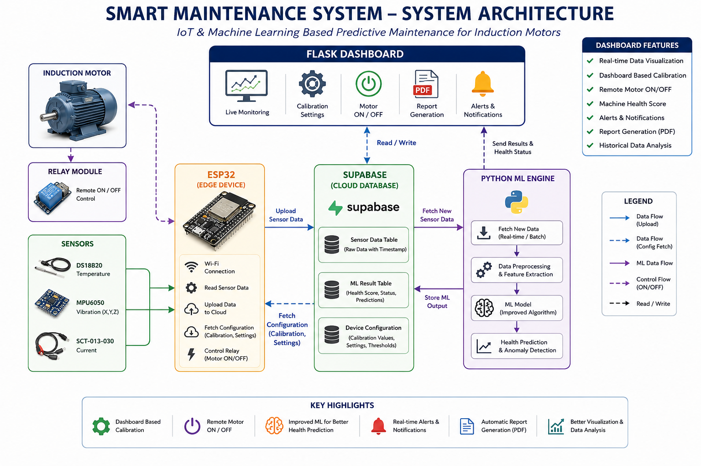

# Smart Maintenance System

An IoT-enabled predictive-maintenance platform for monitoring motor health, classifying equipment condition, and turning sensor readings into maintenance actions and performance reports.

**Live application:** [https://smart-maintenance-system-n97c.onrender.com/](https://smart-maintenance-system-n97c.onrender.com/)

The project combines:

- An ESP32 firmware path for real sensor acquisition.
- A Python sensor simulator for local testing.
- Supabase PostgreSQL for raw readings, predictions, device configuration, and report metadata.
- A scikit-learn Random Forest model for `Normal`, `Warning`, and `Failure` classification.
- A polling ML worker that processes new Supabase rows.
- A Flask web application with authentication, dashboards, charts, history, settings, and PDF reports.
- Render deployment support for the Flask web service.



## Features

### Monitoring and dashboard

- Authenticated Flask dashboard at `/`.
- Latest machine status, timestamp, temperature, current, vibration, load, prediction confidence, and recommended action.
- Total, normal, warning, and failure prediction counters.
- A recent table containing the latest 30 prediction rows.
- Automatic dashboard refresh every five seconds while the browser tab is visible.
- Responsive Bootstrap-based UI with shared layout and static branding.

### Sensor data and prediction

- ESP32 acquisition for:
  - DS18B20 temperature.
  - SCT-013 current measurement through EmonLib.
  - MPU6050 vibration measurement.
- Vibration processing at 200 Hz with gravity estimation, dynamic acceleration, and one-second RMS aggregation.
- Upload of the latest sensor values to Supabase every five seconds.
- Local simulator that generates weighted normal, warning, and failure readings every two seconds.
- Random Forest model trained from `smart_maintenance_dataset.csv`.
- One-hot encoding for `Load_Level`; numeric features are temperature, current, and vibration.
- A rule-based safety override layered over the model:
  - `Failure`: temperature above 90 °C, current above 13 A, or vibration above 0.06 g.
  - `Warning`: temperature above 78 °C, current above 9.5 A, or vibration above 0.028 g.
- Confidence returned with every prediction.
- Recommended actions:
  - Normal: continue operation and monitor routinely.
  - Warning: schedule maintenance inspection soon.
  - Failure: immediate shutdown and urgent inspection required.

### Operations and reporting

- Paginated prediction history (50 rows per page).
- Interactive Chart.js charts for the last 1 hour, 6 hours, 24 hours, 7 days, or 30 days.
- Combined, single-parameter, and grouped chart modes with zoom and pan.
- Device calibration settings stored in `public.device_config`.
- Performance report generation for a selected machine and date range.
- Report preview and PDF download.
- Report regeneration, including handling for an existing report for the same machine and period.
- Reports include status counts and percentages, average confidence, sensor min/average/max values, trends, a summary, and charts.
- PDFs are stored in the Supabase Storage bucket `maintenance-reports`; report metadata and structured report data are stored in `analytics.generated_reports`.

### Authentication

- Supabase email/password login at `/login`.
- Flask session cookies with HTTP-only, `SameSite=Lax`, secure-cookie, and eight-hour permanent-session settings.
- All dashboard, chart, history, report, settings, prediction, and ingestion routes require an authenticated session unless noted below.
- Signup code and UI are present as a template/signup but the Flask signup route is currently commented out.

## Architecture

The application has four runtime parts:

1. **Data producer** — ESP32 firmware or `sensor_simulator.py`.
2. **Supabase** — stores raw sensor readings in the `iot` schema and processed predictions in the `analytics` schema.
3. **ML worker** — `ml_worker.py` polls unprocessed rows, predicts status, writes predictions, and marks rows processed.
4. **Web application** — `app.py` reads predictions and serves the authenticated dashboard, APIs, settings, reports, and PDF downloads.

## Project structure

```text
.
├── app.py                              # Flask web app, authentication, UI routes, and JSON APIs
├── ml_worker.py                        # Polls raw readings and writes model predictions
├── train_model.py                      # Trains and serializes the Random Forest pipeline
├── sensor_simulator.py                 # Generates test readings and inserts them into Supabase
├── report_generator.py                  # Builds report data and renders PDFs with charts
├── Smart_Maintenance_System_Supabase.ino # ESP32 firmware and Supabase REST upload path
├── supabase_schema.sql                  # Schemas, tables, indexes, grants, RLS, and storage policies
├── smart_maintenance_dataset.csv        # Training dataset
├── smart_maintenance_model.pkl          # Generated model artifact (ignored by Git)
├── label_encoder.pkl                    # Generated label encoder artifact (ignored by Git)
├── .env.example                         # Environment-variable template
├── requirements.txt                      # Full local/runtime/training dependency set
├── requirements-render.txt               # Render web-service dependencies plus Gunicorn
├── docs/
│   └── architecture.png                  # System architecture diagram
├── templates/
│   ├── base.html                        # Shared navigation, styling, and Chart.js dependency
│   ├── index.html                       # Operations dashboard and live refresh
│   ├── charts.html                      # Interactive sensor charts
│   ├── history.html                     # Paginated prediction history
│   ├── reports.html                     # Report generation and report list
│   ├── report_exists.html               # Existing-report decision screen
│   ├── report_preview.html               # Report details and download action
│   ├── settings.html                    # Device calibration configuration
│   ├── login.html                       # Supabase login form
│   └── signup.html                      # Signup UI reference; route currently disabled
└── static/
    ├── auth.css                         # Login/signup styles
    └── logo.png                         # Application logo
```

The local `venv/` directory, `.env`, Python caches, and `.pkl` artifacts are excluded by `.gitignore` and are not application source files.

## Technology stack

- Python 3.12.8
- Flask 3.0.3
- Supabase Python client 2.15.1
- Supabase PostgreSQL and Storage
- pandas 2.2.2 and NumPy 2.0.1
- scikit-learn 1.5.1
- joblib 1.4.2
- ReportLab 4.2.2
- Matplotlib 3.9.2
- Bootstrap 5.3.3
- Chart.js and `chartjs-plugin-zoom`
- ESP32 Arduino framework with OneWire, DallasTemperature, EmonLib, and MPU6050
- Gunicorn 23.0.0 on Render

## Prerequisites

- Python 3.12.8 is required for the supported environment.
- A Supabase project with access to the SQL editor, API settings, Authentication, and Storage.
- For hardware ingestion:
  - ESP32 board.
  - DS18B20 temperature sensor.
  - SCT-013 current sensor.
  - MPU6050 accelerometer.
  - Correct wiring and the Arduino libraries used by the firmware.
- For local simulation only, the ESP32 and its libraries are not required.

## Local setup

### 1. Create and activate a virtual environment

Windows PowerShell:

```powershell
python -m venv venv
.\venv\Scripts\Activate.ps1
```

Windows Command Prompt:

```bat
python -m venv venv
venv\Scripts\activate
```

Linux/macOS:

```bash
python3 -m venv venv
source venv/bin/activate
```

### 2. Install dependencies

```bash
pip install -r requirements.txt
```

`requirements.txt` contains the training dependencies. `requirements-render.txt` is intended for the Render web service and does not include scikit-learn or NumPy.

### 3. Configure environment variables

Copy `.env.example` to `.env` and set real values. The application loads `.env` through `python-dotenv`.

```env
SUPABASE_URL=https://YOUR_PROJECT_ID.supabase.co
SUPABASE_SERVICE_ROLE_KEY=YOUR_SUPABASE_SERVICE_ROLE_JWT_KEY
SUPABASE_IOT_SCHEMA=iot
SUPABASE_ANALYTICS_SCHEMA=analytics
WORKER_POLL_SECONDS=2
WORKER_BATCH_SIZE=25
MODEL_VERSION=rf_v1
FLASK_SECRET_KEY=generate-a-long-random-secret
```

`SUPABASE_SERVICE_ROLE_KEY` is preferred by the Python backend. `SUPABASE_ANON_KEY` or the legacy `SUPABASE_KEY` is accepted as a fallback. Do not use a `sb_publishable_...` key in the Python backend.

Generate a Flask secret key with:

```bash
python -c "import secrets; print(secrets.token_hex(32))"
```

### 4. Initialize Supabase

1. Open the Supabase SQL editor.
2. Run [`supabase_schema.sql`](./supabase_schema.sql).
3. Create a Storage bucket named `maintenance-reports` if it does not already exist.
4. Configure Supabase Authentication email/password settings and create at least one user for login.

The schema creates:

- `public.device_config`
- `iot.raw_sensor_readings`
- `analytics.sensor_predictions`
- `analytics.generated_reports`

It also creates indexes, grants, report RLS policies, and storage policies. Review the policies for your security requirements before exposing a production database.

### 5. Train the model

The dataset must contain these columns:

```text
Temp_C, Current_A, Vibration_RMS_g, Load_Level, Status
```

Run:

```bash
python train_model.py
```

This creates `smart_maintenance_model.pkl` and `label_encoder.pkl` in the project root and prints a classification report and confusion matrix. The model uses an 80/20 stratified split and a 200-tree Random Forest.

The generated `.pkl` files are ignored by Git. They must exist wherever `app.py` or `ml_worker.py` needs to perform a non-override prediction.

### 6. Start the services

Start the ML worker:

```bash
python ml_worker.py
```

In another terminal, start Flask:

```bash
python app.py
```

Open [http://127.0.0.1:5000/login](http://127.0.0.1:5000/login), sign in with a Supabase user, and then use the dashboard.

For simulator-driven testing, start a third terminal and run:

```bash
python sensor_simulator.py
```

Stop the worker or simulator with `Ctrl+C`.

## Data flow

### ESP32 or simulator ingestion

1. The ESP32 reads temperature, current, and vibration.
2. The firmware derives `load_level` from current and posts a row to the Supabase REST endpoint for `iot.raw_sensor_readings`.
3. Alternatively, `sensor_simulator.py` creates weighted synthetic readings for machine `M-101`.
4. New rows default to `processed = false`.

### ML processing

1. `ml_worker.py` polls `iot.raw_sensor_readings` every `WORKER_POLL_SECONDS` seconds.
2. It fetches up to `WORKER_BATCH_SIZE` rows ordered by ID where `processed = false`.
3. It applies the safety thresholds first.
4. If no threshold is exceeded, it loads the serialized pipeline and label encoder and predicts from the four feature columns.
5. It upserts one row into `analytics.sensor_predictions`, keyed by `raw_reading_id`.
6. It records status, confidence, alert flag, maintenance action, and `MODEL_VERSION`.
7. It marks the raw row processed with `processed_at`.
8. Rows that fail processing are logged and remain available for a later poll.

### Web application

1. Flask reads prediction rows from `analytics.sensor_predictions`.
2. The dashboard renders the initial state server-side.
3. Browser JavaScript refreshes dashboard data through `/api/dashboard-data`.
4. Charts request the selected time window through `/api/chart-data`.
5. Report generation reads a machine/date range, computes statistics, renders a PDF, uploads it to Supabase Storage, and stores report metadata in `analytics.generated_reports`.
6. PDF downloads retrieve the stored object through Supabase Storage.

## Web routes

| Method | Path | Auth | Purpose |
|---|---|---:|---|
| `GET`, `POST` | `/login` | No | Render login form and authenticate with Supabase |
| `GET` | `/logout` | No | Sign out and clear the Flask session |
| `GET` | `/` | Yes | Operations dashboard |
| `GET` | `/history` | Yes | Paginated prediction history; accepts `page` |
| `GET` | `/charts` | Yes | Interactive charts; accepts `range` |
| `GET` | `/reports` | Yes | List machines and generated reports; accepts `machine_id` |
| `POST` | `/reports/generate` | Yes | Create a performance report or show the existing-report decision page |
| `POST` | `/reports/generate-new` | Yes | Generate another report for an existing machine/date range |
| `GET` | `/reports/<report_id>` | Yes | Preview a stored report |
| `POST` | `/reports/<report_id>/update` | Yes | Recompute and update an existing report |
| `GET` | `/reports/<report_id>/download` | Yes | Download the stored PDF |
| `GET` | `/settings` | Yes | View device configurations |
| `POST` | `/settings/save` | Yes | Insert or update a device configuration |
| `POST` | `/settings/delete` | Yes | Delete a device configuration |
| `GET` | `/api/health` | No | Return a simple service health response |
| `GET` | `/api/dashboard-data` | Yes | Return dashboard metrics, latest data, recent rows, and chart data |
| `GET` | `/api/chart-data` | Yes | Return chart series; accepts `range=1h`, `6h`, `24h`, `7d`, or `30d` |
| `POST` | `/api/predict` | Yes | Predict from a JSON body without storing the reading |
| `POST` | `/api/ingest` | Yes | Explicitly disabled; returns HTTP 410 and directs callers to Supabase |
| `GET` | `/seed-demo` | Yes | Compatibility route that currently redirects to the dashboard and does not seed data |

### `/api/predict` request and response

Request:

```json
{
  "temp_c": 72.4,
  "current_a": 8.2,
  "vibration_rms_g": 0.031,
  "load_level": "High"
}
```

Successful response:

```json
{
  "predicted_status": "Warning",
  "confidence": 0.95,
  "maintenance_action": "Schedule maintenance inspection soon"
}
```

Missing or invalid fields return HTTP 400. If model artifacts are unavailable, a prediction that needs the model returns HTTP 503. The endpoint does not store input data.

### `/api/health` response

```json
{
  "status": "ok",
  "message": "Smart Maintenance API is running"
}
```

## Database model

### `public.device_config`

Stores per-device `device_id`, current-sensor `calibration`, current-transformer `turns`, and vibration filter `alpha` (constrained from 0 to 1). The ESP32 reads its configuration once at startup and falls back to firmware defaults if the request fails.

### `iot.raw_sensor_readings`

Stores the ingestion record:

- `id`, `machine_id`, `event_ts`, `created_at`
- `temp_c`, `current_a`, `vibration_rms_g`, `load_level`
- `source` (`esp32` or `simulator`)
- `processed`, `processed_at`

### `analytics.sensor_predictions`

Stores the one-to-one processed result for each raw row:

- Original reading identifiers and sensor values.
- `predicted_status`, `confidence`, and `alert_flag`.
- `maintenance_action`.
- `model_version` and `created_at`.

### `analytics.generated_reports`

Stores report identity, date range, status counts/percentages, sensor statistics, `overall_status`, summary, complete JSON `report_data`, and the Supabase Storage `file_path`.

## Model and report logic

### Prediction thresholds

Threshold checks run before the Random Forest:

| Result | Condition |
|---|---|
| `Failure` | `temp_c > 90` OR `current_a > 13` OR `vibration_rms_g > 0.06` |
| `Warning` | `temp_c > 78` OR `current_a > 9.5` OR `vibration_rms_g > 0.028` |
| Model result | None of the override conditions is met |

The override confidence is `0.99` for Failure and `0.95` for Warning. The model confidence is the largest class probability.

### Report status

For a selected machine and inclusive date range:

- `Failure` when failure predictions are at least 10% of readings.
- `Warning` when failure predictions are at least 5% or warning predictions are at least 10%.
- `Normal` otherwise.
- `Unknown` when there are no readings.

Temperature, current, and vibration trends compare the first and last valid values: above 5% is Increasing, below -5% is Decreasing, otherwise Stable. Charts are reduced to at most approximately 300 points for PDF generation.

## Render deployment

The repository is prepared for a Render Python web service. Deploy the web application as follows:

1. Push the repository to GitHub.
2. In Render, choose **New → Web Service** and connect the repository.
3. Use the Python runtime and the project root as the service root.
4. Configure:
   - **Build command:** `pip install -r requirements-render.txt`
   - **Start command:** `gunicorn app:app`
5. Add the environment variables listed in `.env.example` in Render's Environment settings:
   - `PYTHON_VERSION=3.12.8`
   - `SUPABASE_URL`
   - `SUPABASE_SERVICE_ROLE_KEY` (or an appropriate Supabase JWT key)
   - `SUPABASE_IOT_SCHEMA=iot`
   - `SUPABASE_ANALYTICS_SCHEMA=analytics`
   - `WORKER_POLL_SECONDS=2`
   - `WORKER_BATCH_SIZE=25`
   - `MODEL_VERSION=rf_v1`
   - `FLASK_SECRET_KEY`
6. Deploy and wait for the service to become healthy.
7. Verify `https://<your-render-service>.onrender.com/api/health`.
8. Open `/login` and sign in with a Supabase Authentication user.

Set `PYTHON_VERSION` to `3.12.8` in the Render Environment settings so the service uses the same Python version as local development.

### Render deployment notes

- Render runs the Flask web service; `ml_worker.py` is a separate long-running process and must also be run somewhere if incoming rows should be processed automatically. A Render Background Worker is the natural separate service for `python ml_worker.py`.
- The service must have `smart_maintenance_model.pkl` and `label_encoder.pkl` available at runtime for model-backed predictions. Because `.pkl` files are ignored by Git, include a reproducible artifact/build step or provide the artifacts through the deployment process.
- The Render requirements file intentionally omits training-only packages. If Render is also responsible for running `train_model.py`, use the full requirements or add the training dependencies to the build process.
- Render supplies the public HTTPS URL, which is compatible with the secure session-cookie setting.
- Supabase credentials belong in Render environment variables, never in source control or browser JavaScript.
- The current application is not a single-process ingestion pipeline: the Flask `/api/ingest` route returns HTTP 410, so hardware and simulator data should be sent directly to Supabase.

## ESP32 setup

1. Open `Smart_Maintenance_System_Supabase.ino` in the Arduino IDE.
2. Install the libraries included by the sketch: OneWire, DallasTemperature, EmonLib, and an MPU6050 library.
3. Replace the Wi-Fi SSID/password and Supabase URL/key placeholders.
4. Confirm the REST URL points to the `raw_sensor_readings` table and that the Supabase profile headers target the `iot` schema.
5. Confirm the device configuration row exists for `motor_1`, or keep the firmware defaults:
   - Calibration: `52`
   - Turns: `2`
   - Alpha: `0.02`
6. Flash the board and monitor the serial output at 115200 baud.

The sketch uses GPIO 4 for the DS18B20 data line, GPIO 34 for current sensing, and I2C pins 21/22 for the MPU6050. Validate the wiring and electrical safety of the current-sensing circuit before operation.

## Security and operational notes

- Never commit `.env`, Supabase keys, Flask secrets, or hardware credentials.
- Keep the service-role key server-side. Do not place it in the ESP32 firmware unless the database policies and deployment threat model explicitly justify that risk; an anon key with narrowly scoped policies is safer for a device.
- Review the permissive Supabase grants and storage policies in `supabase_schema.sql` before production use.
- Supabase login establishes a Flask session, but the current server-side data queries use the configured Supabase key rather than forwarding the user's access token as a row-level authorization context.
- `SESSION_COOKIE_SECURE=True` assumes the application is accessed over HTTPS; use an appropriate local HTTPS setup if testing secure cookies outside Render.
- The worker uses polling and a processed flag. It is intentionally simple and can be replaced later with Supabase Realtime or webhook-driven processing.
- `insert_prediction` is idempotent for a raw row through the unique `raw_reading_id` constraint.
- Failed worker rows are printed and remain unprocessed for a later retry.
- The report generation flow creates a new storage object and then stores its path in the report metadata.
- The application has no automated test suite in the repository. Validate local changes with a running Supabase project, the health endpoint, a prediction request, and an end-to-end simulator/worker cycle.

## Troubleshooting

| Symptom | Checks |
|---|---|
| `Missing SUPABASE_URL...` | Confirm `.env` or Render environment variables and restart the process. |
| Publishable-key error | Replace `sb_publishable_...` with a Supabase anon or service-role JWT key. |
| Model files not found | Run `python train_model.py` and ensure both `.pkl` files are present beside `app.py`. |
| Raw rows remain unprocessed | Confirm `ml_worker.py` is running, the schemas exist, the key can read/write both schemas, and the model artifacts are available. |
| Dashboard is empty | Log in, verify `analytics.sensor_predictions` contains rows, and check worker output. |
| Reports cannot upload | Confirm the `maintenance-reports` bucket exists and its policies permit the configured key. |
| Local login appears not to persist | Use HTTPS or temporarily use a development-only cookie configuration; production should retain secure cookies. |
| ESP32 uses default calibration | Confirm `public.device_config` has `device_id = motor_1`, the REST request succeeds, and the response is valid JSON. |

## License

No license file is currently included in the repository. Add a license before distributing the project outside its intended project context.
